# Brand Codex

**Turn the brand you already have into a brand guideline you can publish.**

Brand Codex is a skill for Claude. It interviews you about your existing
brand, collects your logo files and exact values, checks them for errors,
and builds a polished brand guidelines deck in PowerPoint. It also produces
a handoff kit so Canva, Claude Design, and other AI tools can apply your
brand correctly.

Brand Codex does **not** design a brand. It records the decisions you have
already made, asks about the ones nobody wrote down, and presents the
result so agencies, partners, new hires, and AI tools can follow it
without asking.

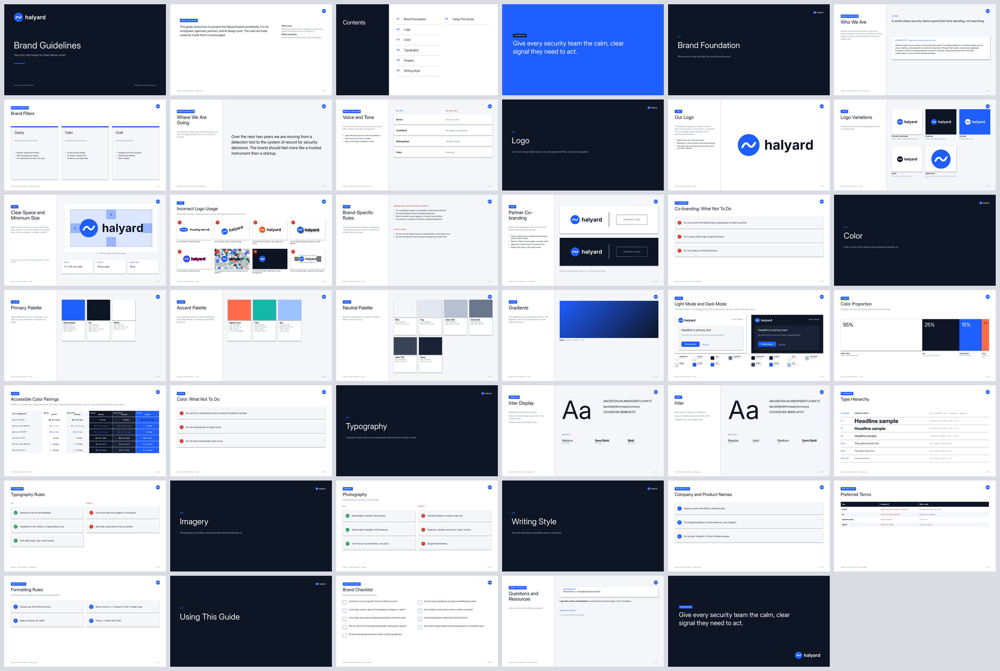

*A complete 41-slide guide generated for Halyard, a fictional company used
as the example throughout this package.*

---

## Contents

1. [What you get](#what-you-get)
2. [Screenshots](#screenshots)
3. [How it works](#how-it-works)
4. [Install](#install)
5. [Use it](#use-it)
6. [Requirements](#requirements)
7. [Update your guide later](#update-your-guide-later)
8. [What is in this package](#what-is-in-this-package)
9. [Limitations](#limitations)
10. [Background](#background)
11. [License](#license)

---

## What you get

| Output | What it is |
|---|---|
| **Brand guidelines deck** (`.pptx`) | A 16:9 PowerPoint built from your real logo files and exact values. Sections with no data are left out, not padded with placeholder text. |
| `brand-guidelines.md` | The complete guide in plain text. It opens with instructions written for AI tools, so you can paste it into any assistant. |
| `canva-brand-kit.md` | Step-by-step Canva Brand Kit setup: which logos to upload, palettes with exact HEX values, font styles, brand voice text, and do's and don'ts to paste into each category. |
| `claude-design-setup.md` | How to load the brand into Claude Design, Claude Projects, and Claude Code, with a test prompt. |
| `design-tokens.json` | Colors, light and dark mode roles, fonts, and type scale in the W3C Design Tokens format. |
| `tokens.css` | The same tokens as CSS variables, including a dark theme. |
| `logos/` | Your original files plus transparent PNG exports, named consistently. |
| `brand.json` | The single source of truth. Edit it and rebuild everything in a minute. |

### What the deck covers

- **Foundation:** mission, vision, positioning, boilerplate, pillars,
  values, company direction, voice and tone ("we are / we are not"), and
  audiences
- **Logo:** primary logo, every variation and the background it belongs
  on, clear space diagram, minimum sizes, approved background pairings,
  **misuse examples generated from your actual logo**, brand-specific rules
  (where the logo must never appear), and lockups
- **Brand architecture** and **partner co-branding**, when relevant
- **Color:** palettes with HEX, RGB, CMYK, and Pantone; gradients;
  **light mode and dark mode** shown side by side; color proportion; and a
  **WCAG contrast table calculated from your values**
- **Typography:** specimens, weights, fallbacks, full type hierarchy, and
  rules
- **Imagery:** photography, illustration, icons, and graphic elements, with
  do and don't examples
- **Writing style:** name usage, preferred terms, and formatting rules
- **Governance:** a pre-publish checklist, contacts, asset locations, and
  version history

---

## Screenshots

All screenshots come from the included example deck
(`examples/halyard-example-brand-guidelines.pptx`). They were rendered with
LibreOffice, so fonts may look slightly different from PowerPoint.

**Cover and mission**

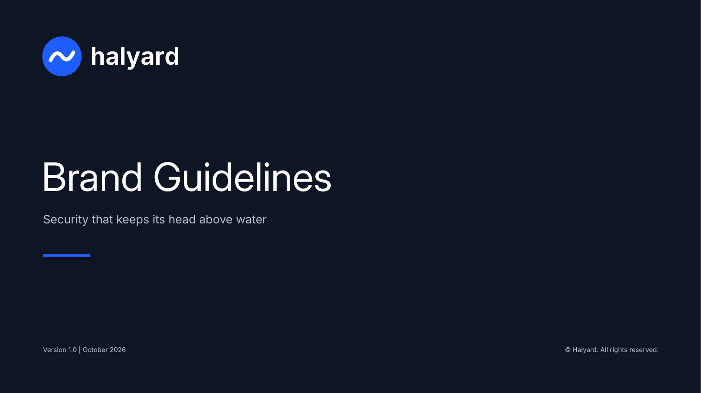
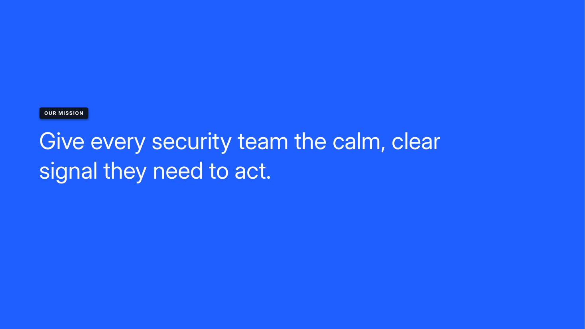

**Voice and tone**

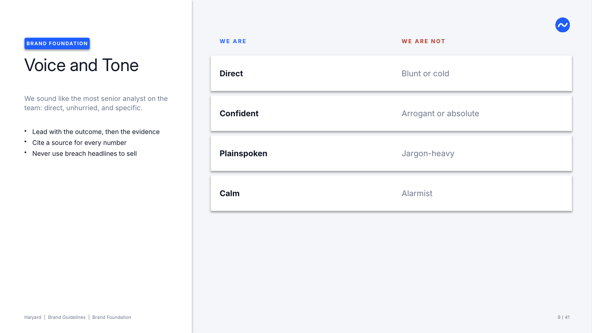

**Logo variations, each shown on the background it is made for**

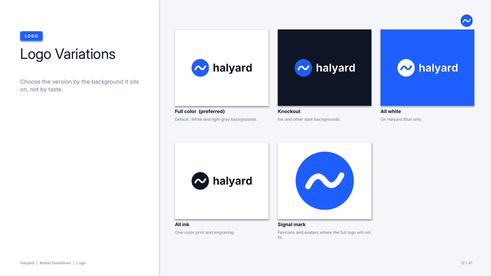

**Clear space and minimum size, drawn from your clear space rule**

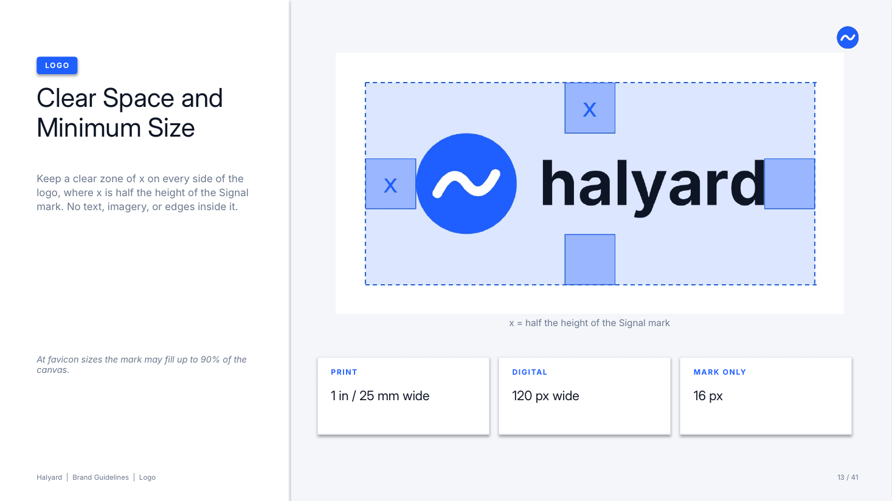

**Incorrect usage, generated from your own logo file**

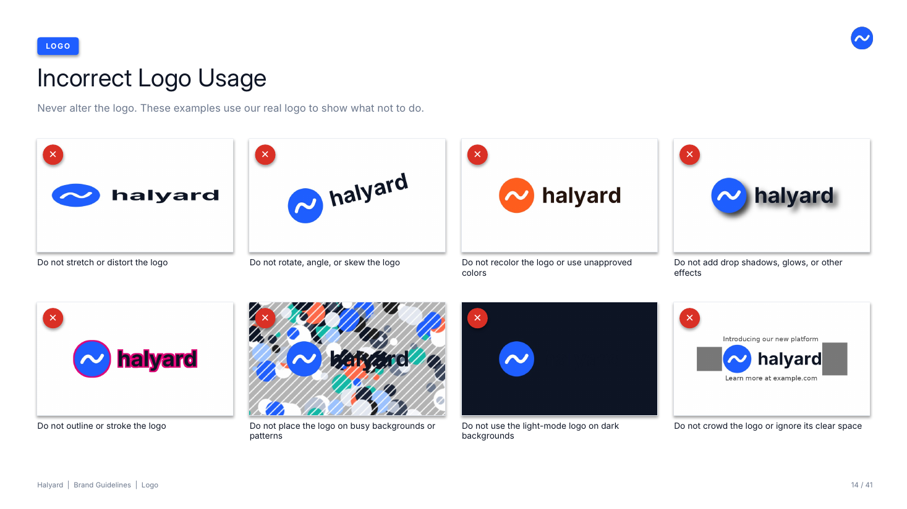

**Partner co-branding**

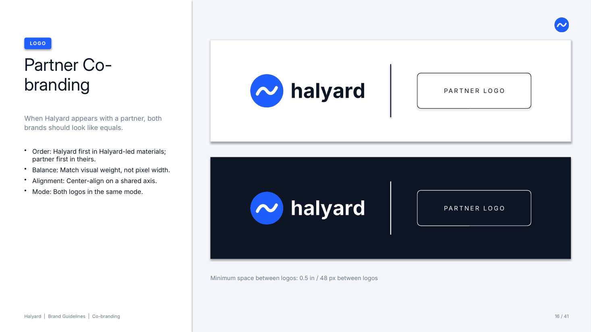

**Color palette with print values**

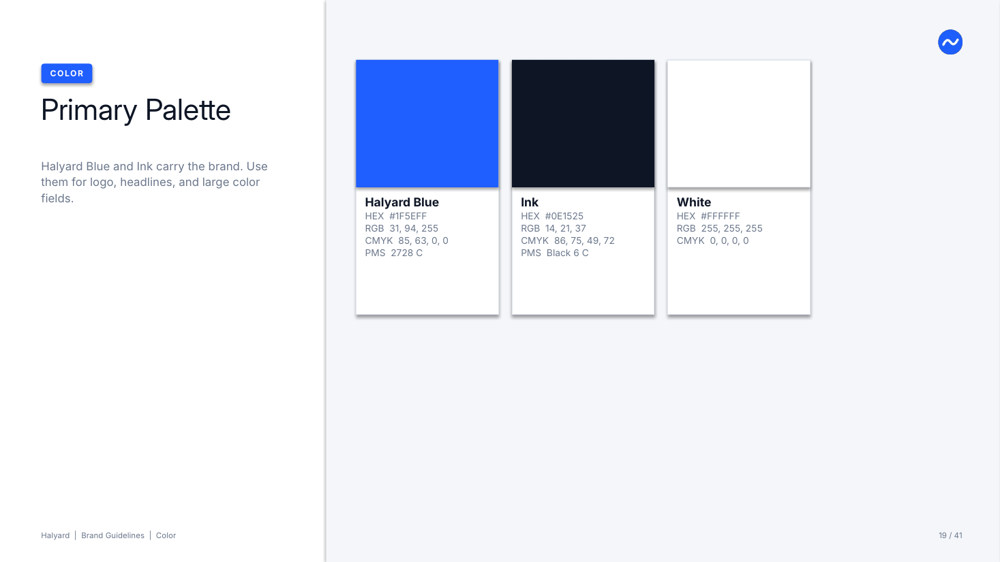

**Light mode and dark mode**

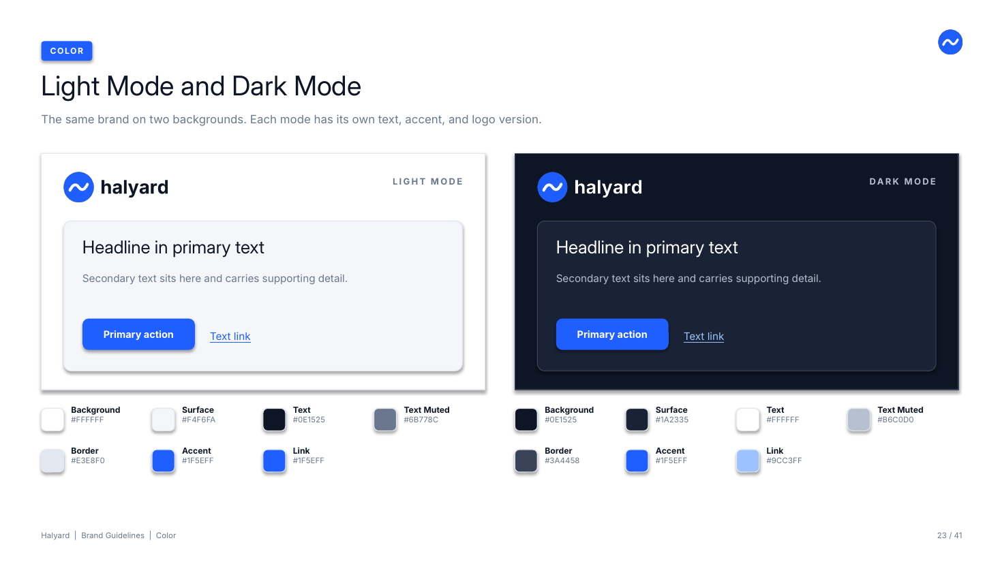

**Contrast table, calculated from your HEX values**

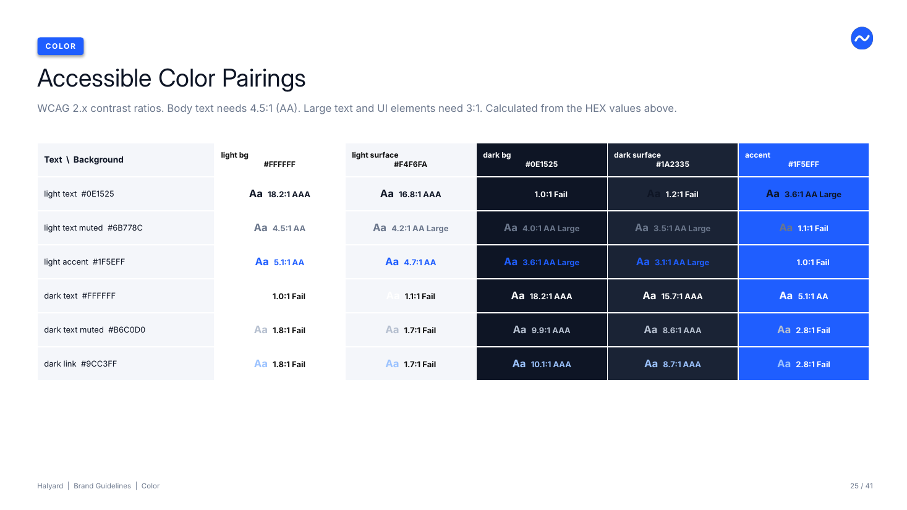

**Type hierarchy**

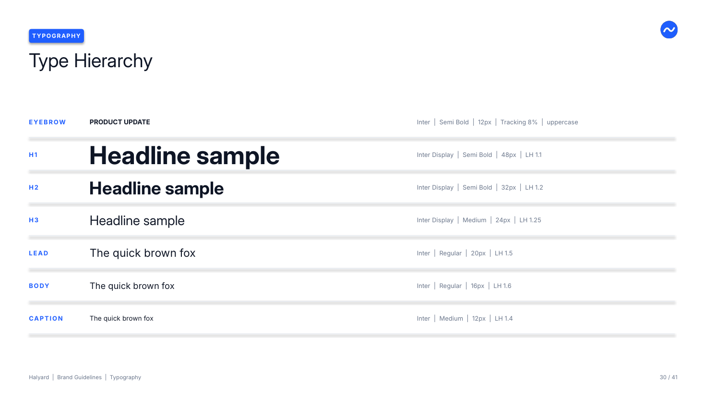

**Photography do's and don'ts**

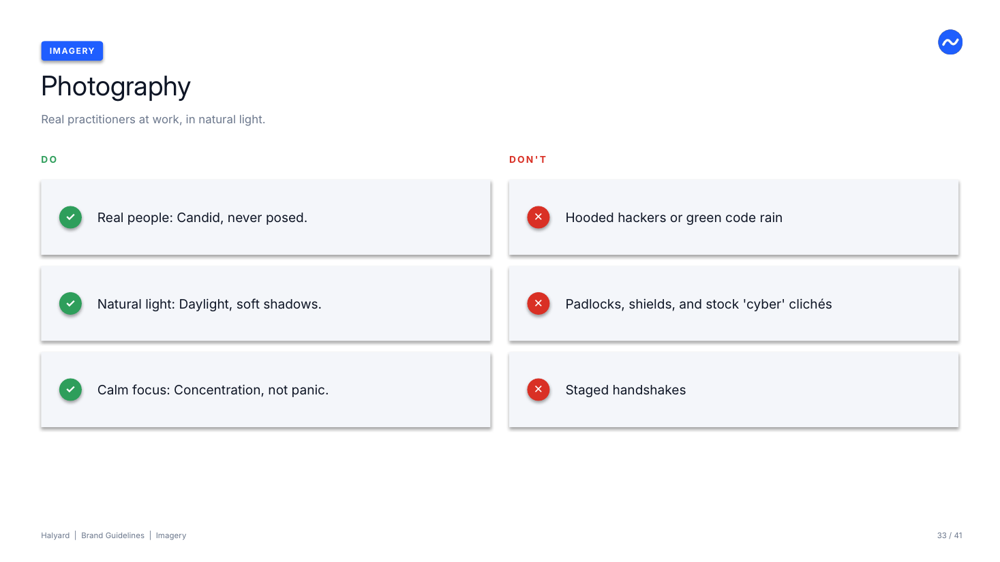

**Brand checklist**

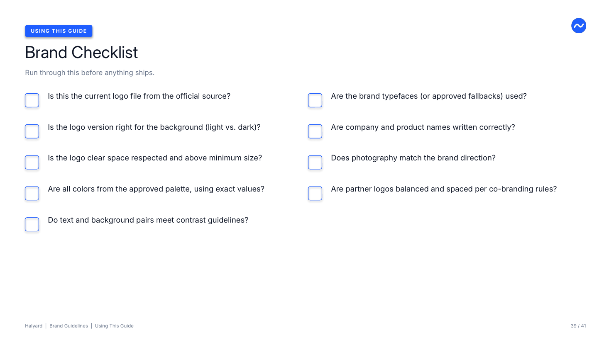

---

## How it works

1. **Kickoff.** Claude asks for your existing brand guide (if any), every
   logo file you have, who the guide is for, and how strict it should read.
2. **Existing guide shortcut.** If you upload an old guide, Claude extracts
   every value from it, checks them, shows you what is missing, and only
   asks about the gaps.
3. **Logo inventory.** A script analyzes each logo file: size,
   transparency, colors, which background it seems built for, and whether
   it looks like a full logo, stacked logo, or mark. You confirm or correct.
4. **Interview.** Short batches of three to five questions, one topic at a
   time: company and direction, voice, logo, co-branding, color (with full
   light and dark mode sets), typography, imagery, writing style, and
   governance. **Every topic ends with "what does not work"**: where the
   logo must never appear, colors never to combine, fonts to avoid, photos
   that are off-brand.
5. **Validation.** A checker catches the errors that real brand guides
   ship with: HEX and RGB values that disagree, Pantone codes copied onto
   different colors, malformed HEX, font names that do not match, logo
   files assigned to the wrong background, and text and background pairs
   that fail accessibility contrast. Claude asks you which value is right.
   It never silently "fixes" your brand.
6. **Build.** The deck is generated from `brand.json`, then rendered and
   reviewed slide by slide for layout problems.
7. **Handoff.** The Canva, Claude Design, token, and markdown files are
   exported and zipped.

### Rules the skill follows

- **Record, do not invent.** Claude never makes up colors, print values,
  clear space rules, fonts, or boilerplate. If something is undefined, you
  choose: leave it out, or let Claude suggest a value that is labeled
  **PROPOSED** in the deck until you approve it.
- **No computed print colors.** If you only have HEX values, CMYK and
  Pantone stay blank and are flagged. Screen-to-print conversion depends on
  paper and press; a wrong value is worse than a blank one.
- **One source of truth.** Every value lives once in `brand.json`, so the
  deck can never contradict itself.

---

## Install

The skill is in two formats in the `install/` folder:

- `brand-codex.zip` for Claude on the web and desktop apps
- `brand-codex.skill` (same contents, for tools that accept `.skill` files)

### Claude (web and desktop)

Skills are available on Free, Pro, Max, Team, and Enterprise plans.

1. Turn on code execution. On Free, Pro, and Max, go to **Settings >
   Capabilities** and turn on **Create and edit files** (it may be labeled
   "Code execution and file creation"). On Team and Enterprise, an owner
   enables code execution and Skills in **Organization settings > Plugins &
   skills**.
2. Go to **Customize > Skills**.
3. Click **+**, choose **Create skill**, then **Upload a skill**.
4. Upload `install/brand-codex.zip`. Do not unzip it first.
5. Turn the skill on in your list.

**Share with your team (Team and Enterprise):** in **Customize > Skills**,
open the three-dot menu next to Brand Codex and choose **Share**, or open
the skill and choose **Publish to org**. Sharing must first be allowed by
an owner under **Organization settings > Plugins & skills > Policy**.

Menu names change from time to time. If these steps do not match what you
see, follow Anthropic's current instructions:
[Use skills in Claude](https://support.claude.com/en/articles/12512180-use-skills-in-claude).

### Claude Code

Copy the skill folder into your skills directory. Claude Code picks it up
without a restart.

**For you, in every project:**
```bash
mkdir -p ~/.claude/skills
cp -r skill/brand-codex ~/.claude/skills/
```

**For one repository (commit it so your team gets it):**
```bash
mkdir -p .claude/skills
cp -r skill/brand-codex .claude/skills/
```

Then install the Python dependencies (see [Requirements](#requirements)).
Reference: [Claude Code skills documentation](https://code.claude.com/docs/en/skills).

### Claude API

Skills are in beta on the API. Upload the `skill/brand-codex` folder by
following [Anthropic's Agent Skills documentation](https://platform.claude.com/docs/en/agents-and-tools/agent-skills/overview).

---

## Use it

Once installed, start a conversation and say what you need. Claude loads
the skill automatically when the request is about brand guidelines. You
can also name it directly.

Example prompts:

> Use Brand Codex to build our brand guidelines. Here are our logos and our
> old brand PDF from 2021.

> I need a brand guide for our partners. We have logo files and a few colors
> but nothing written down.

> Set up our brand for Canva and Claude Design. Our logo files are attached.

> Here is our brand.json from last quarter. We added a dark mode and a new
> accent color. Update the guide.

**What to have ready** (all optional, but each one saves questions):

- Every logo file you have, ideally SVG or transparent PNG at least 1000
  pixels wide
- Your existing brand guide, style guide, or a deck that looks right
- Exact color values, including CMYK and Pantone if you print
- Font names and where they are licensed from
- Three to six example photos you consider on-brand, plus a couple you do
  not
- Screenshots of past logo misuse (these make the strongest "don't"
  examples)

A first full guide usually takes several rounds of conversation. With an
existing guide uploaded, most of the work is confirming and filling gaps.

---

## Requirements

The skill runs Python scripts. Claude's built-in environment on the web and
desktop apps typically has what it needs; Claude installs anything
missing. For Claude Code or your own machine:

```bash
pip install python-pptx Pillow cairosvg
```

| Package | Why |
|---|---|
| `python-pptx` | Builds the PowerPoint |
| `Pillow` | Logo analysis, misuse examples, clear space diagrams |
| `cairosvg` | Only needed for SVG logos |
| LibreOffice (optional) | Renders the deck to images for visual checking |

**Fonts:** the deck names your brand fonts. Anyone opening it without those
fonts installed will see a substitute until they install them. If that is
a problem, ask Claude to build with fallback fonts.

---

## Update your guide later

Keep `brand.json` with your deliverables. To update:

1. Start a conversation, upload `brand.json` and any new files, and say
   what changed.
2. Claude updates the file, bumps the version and date (after asking),
   adds a version history entry, validates, and rebuilds the deck and
   handoff kit.

You can also run the scripts yourself:

```bash
python skill/brand-codex/scripts/validate_brand.py brand.json
python skill/brand-codex/scripts/build_deck.py brand.json out/brand-guidelines.pptx
python skill/brand-codex/scripts/export_handoff.py brand.json out/handoff
```

---

## What is in this package

```
brand-codex-package/
├── README.md                     this file
├── LICENSE                       MIT
├── CHANGELOG.md
├── .gitignore
├── install/
│   ├── brand-codex.zip           upload this to Claude (web/desktop)
│   └── brand-codex.skill         same skill, .skill format
├── skill/brand-codex/            the skill source
│   ├── SKILL.md                  instructions Claude follows
│   ├── LICENSE.txt               MIT (travels with the installed skill)
│   ├── references/
│   │   ├── anatomy.md            what a brand guideline contains and why
│   │   ├── interview.md          question bank, including "what does not work"
│   │   └── brand-schema.md       every brand.json field
│   ├── scripts/
│   │   ├── inspect_assets.py     analyzes logo files
│   │   ├── validate_brand.py     catches value, contrast, and file errors
│   │   ├── build_deck.py         brand.json to PowerPoint
│   │   ├── misuse.py             generates incorrect-usage examples
│   │   ├── export_handoff.py     Canva, Claude Design, tokens, markdown
│   │   └── brandlib.py           shared helpers
│   └── assets/
│       ├── brand.template.json   empty starting structure
│       └── example/              fictional Halyard brand with logos
├── examples/
│   ├── halyard-example-brand-guidelines.pptx
│   └── halyard-example-handoff.zip
├── docs/
│   └── anatomy-of-a-brand-guideline.md
└── screenshots/
```

---

## Limitations

- **It presents a brand; it does not create one.** If you need a new logo
  or palette, work with a designer first, then use Brand Codex to document
  the result.
- **Logo quality in, logo quality out.** Opaque JPGs and small PNGs work,
  but the background is cut out automatically and edges can look rough.
  Supply SVG or transparent PNG for a publishable guide.
- **Canva and Claude Design instructions describe interfaces that change.**
  The values in the handoff files are what matter; menu names may differ.
- **The deck is a strong starting point, not a final design.** It is built
  with editable PowerPoint shapes and text, so a designer can refine it.
- **Clear space diagrams are drawn from a ratio of logo height.** If your
  rule is based on a specific letter or element, the diagram is an
  approximation and the written rule is what governs.

---

## Background

Brand Codex was designed by studying professionally produced brand
guidelines from up and coming, brand forward companies, including lean, visual-first guides and comprehensive guides covering voice, personas, sub-brand
architecture, co-branding, and editorial style. The structure of the
generated deck combines the strengths of both. The validator exists
because both guides contained value errors (mismatched HEX and RGB values,
duplicated print codes, and contradictory font names) that a single source
of truth prevents. The full analysis is in `docs/anatomy-of-a-brand-guideline.md`.

Halyard is a fictional company. Its name, logo, and values exist only to
demonstrate the skill.

**Version:** 1.0.0, October 28, 2026

---

## License

Brand Codex is released under the [MIT License](LICENSE).
Copyright (c) 2026 Richard Melick.

You are free to use, modify, and share it, including commercially, as long
as the copyright notice and license text stay with it. Brand guides you
create with Brand Codex are yours; the license covers the skill itself, not
your output.